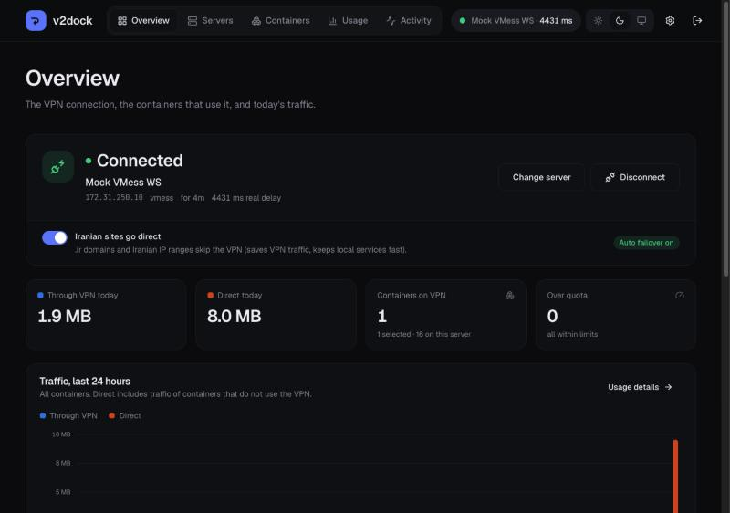
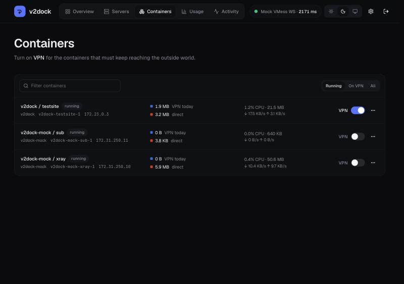

# v2dock

**Route chosen Docker containers through V2Ray/Xray — keep your servers
connected to the international internet during shutdowns.**

[فارسی](#فارسی) · [Security model](docs/security.md) · [CLI](docs/cli.md) · [Coolify](docs/coolify.md)

v2dock runs next to your other containers (plain Docker or
[Coolify](https://coolify.io)). You add your V2Ray subscriptions, pick a
server, and switch **VPN** on for the containers that must keep reaching the
outside world. Their traffic is diverted transparently at the host — no proxy
settings, no image changes, no restarts — while Iranian destinations go
direct (on by default) so local services stay fast and VPN traffic stays low.



## Features

- **Subscriptions**: add one or many (v2rayN/v2rayNG base64 format), auto
  update on a schedule, shows plan usage and expiry from the panel, and falls
  back to **downloading through the VPN** when the direct route is cut.
  Single links (vless, vmess, trojan, ss, hysteria2) can be added by hand.
- **Server tests**: real delay (an HTTP request through the server, like
  v2rayN) and TCP ping, for one list or everything, with live progress.
- **One-click connect**, or **Connect fastest**.
- **Per-container routing**: a switch per container. The choice follows the
  container across redeploys (Coolify included).
- **Iranian traffic direct** (default on): `.ir`, `geosite:ir` and `geoip:ir`
  bypass the VPN. DNS for foreign names is resolved through the VPN (DoH), so
  poisoned local DNS answers do not break routed containers.
- **Usage and charts** per container: bytes through the VPN vs direct, CPU and
  memory, for 1 h / 24 h / 7 d / 30 d.
- **VPN quotas** per container (daily / weekly / monthly / total). When the
  limit is hit, either block international traffic or fall back to the normal
  network, until the next period.
- **Health checks and automatic failover**: if the active server stops
  answering, v2dock tests the others and switches to the fastest working one.
- **Activity log** of connections, failovers, quota events and every admin
  action (with client IP).
- **CLI for scripts and AI agents**: `--json` everywhere, stable exit codes,
  works over the local socket or remotely with an API token.
- **Security first**: three-process privilege separation, read-only Docker
  access without container secrets, Argon2id, optional TOTP 2FA, scoped API
  tokens, CSRF protection, strict CSP. See [docs/security.md](docs/security.md).

## How it works

```
                    ┌──────────────────────────── host ────────────────────────────┐
 browser ─► Traefik ─► web (uid 65532, no caps) ──unix socket──► agent (host net, NET_ADMIN)
                    │                                              │  Xray (embedded)
                    │   guard (no network) ◄──unix socket──────────┘  nftables redirect
                    │     │ GET-only allowlist                         ▲
                    │   docker.sock                                    │ redirected TCP + DNS
                    │                                                  │
                    │   your-app container ── traffic ─► bridge ── prerouting ──┘
                    └──────────────────────────────────────────────────────────────┘
```

New TCP connections from selected containers (matched by source IP, kept in
sync with Docker events) are redirected by an nftables NAT rule in the
`ip v2dock` table to Xray running inside the agent; DNS queries are redirected
too and answered by Xray (foreign names over DoH through the VPN, Iranian names
by the host's resolver), which also defeats poisoned local DNS answers. Xray
sniffs the destination, sends Iranian destinations and private ranges direct,
everything else through the active server, and counts bytes per container.
Nothing else on the host is touched, existing connections are not reset, and
the rules are removed when v2dock stops. UDP other than DNS is not proxied.

## Install

### Coolify

1. **New Resource → Docker Compose** (from this public repository:
   `https://github.com/SaeedCodez/v2dock`, branch `main`, compose file
   `docker-compose.yml`), or paste [docker-compose.yml](docker-compose.yml)
   as a Docker Compose service.
2. Set a domain on the **web** service (port 8080).
3. Deploy. The admin password is in the resource's environment variables as
   `SERVICE_PASSWORD_ADMIN` (Coolify generates it).

The agent uses `network_mode: host`; Coolify leaves such services out of its
networks and proxy, which is expected — only `web` is exposed. Details:
[docs/coolify.md](docs/coolify.md).

### Docker Compose

```sh
git clone https://github.com/SaeedCodez/v2dock && cd v2dock
cp .env.example .env            # optionally set V2DOCK_ADMIN_PASSWORD
docker compose up -d
```

Then put a reverse proxy with TLS in front of the `web` service (port 8080),
or for a quick local try: `docker compose -f docker-compose.yml -f docker-compose.local.yml up -d --build`
and open http://localhost:8088. Without `V2DOCK_ADMIN_PASSWORD`, get the
one-time setup token with `docker compose logs agent | grep setupToken`.

Images are published to `ghcr.io/saeedcodez/v2dock` (amd64, arm64). GHCR is
reachable from Iranian servers where Docker Hub refuses to serve; pin a
version with `V2DOCK_VERSION`.

### Requirements

- Linux host with nftables (every current distribution), Docker 20.10+.
- IPv4 Docker networks (the default).
- If the host runs UFW or another firewall that drops `INPUT` by default,
  v2dock adds one rule accepting only its own marked packets. Hosts using
  firewalld in nftables mode may need the Docker zone trusted.

## Use

1. **Servers → Add subscription**, paste the URL. Run **Real delay**.
2. **Connect** a server (or **Connect fastest** on the overview).
3. **Containers**: switch **VPN** on for the containers that need the outside
   world. Optionally set a VPN quota from the row menu.
4. Watch **Usage** and **Activity**.



Test it with the bundled network-check site:

```sh
docker compose -f docker-compose.yml -f docker-compose.local.yml -f testsite/docker-compose.yml up -d --build
```

Open http://localhost:8089, then turn on VPN for `testsite` in v2dock and run
the checks again: the egress IP changes to the server's, filtered services
become reachable, and Iranian sites still go direct.

## CLI

```sh
AGENT=$(docker ps --filter label=io.v2dock.role=agent --format '{{.Names}}')
docker exec $AGENT v2dock status
docker exec $AGENT v2dock sub add 'https://panel.example.com/sub/XXXX'
docker exec $AGENT v2dock server test --wait
docker exec $AGENT v2dock connect --best
docker exec $AGENT v2dock route add my-api --quota 50GB --period monthly
docker exec $AGENT v2dock --json usage --range 7d
```

Full reference: [docs/cli.md](docs/cli.md). AI agents: see
[AGENTS.md](AGENTS.md) and the skill in `.claude/skills/v2dock`.

## Development

```sh
cd ui && npm ci && npm run build && cd ..
go test ./...
docker compose -f dev/mock/docker-compose.yml up -d   # a fake foreign V2Ray server
```

See [dev/README.md](dev/README.md).

---

## فارسی

**v2dock** ترافیک کانتینرهای انتخابی داکر را از طریق V2Ray/Xray عبور می‌دهد تا
سرورها در زمان قطعی اینترنت بین‌الملل همچنان به بیرون دسترسی داشته باشند.

- یک یا چند **سابسکریپشن** اضافه کنید؛ به‌روزرسانی خودکار دارد و اگر دانلود
  مستقیم قطع باشد، از طریق خود VPN دانلود می‌کند.
- **تست تأخیر واقعی** و **TCP ping** برای سرورها، و اتصال با یک کلیک (یا
  «اتصال به سریع‌ترین»).
- برای هر کانتینر یک سوییچ **VPN**؛ ترافیک آن بدون تغییر تنظیمات یا ری‌استارت،
  به‌صورت شفاف از VPN رد می‌شود. انتخاب شما بعد از دیپلوی دوباره (کولیفای)
  حفظ می‌شود.
- گزینهٔ **عبور مستقیم ترافیک ایران** (پیش‌فرض روشن): دامنه‌های ‎.ir، لیست
  geosite:ir و رنج IPهای ایران از VPN رد نمی‌شوند.
- **گزارش و نمودار** مصرف هر کانتینر: ترافیک VPN در برابر مستقیم، CPU و حافظه.
- **سقف مصرف VPN** برای هر کانتینر (روزانه، هفتگی، ماهانه یا کل)؛ بعد از رسیدن
  به سقف، یا ترافیک خارجی مسدود می‌شود یا کانتینر به شبکهٔ عادی برمی‌گردد.
- **بررسی سلامت و جابه‌جایی خودکار** به سریع‌ترین سرور سالم وقتی سرور فعلی از کار بیفتد.
- **CLI** با خروجی JSON برای ایجنت‌های هوش مصنوعی و اسکریپت‌ها.
- **امنیت**: سه سرویس جدا با حداقل دسترسی، دسترسی فقط‌خواندنی به داکر (بدون
  دیدن رمزهای کانتینرها)، Argon2id، احراز هویت دومرحله‌ای، توکن‌های API با سطح
  دسترسی، محافظت CSRF و CSP سخت‌گیرانه.

نصب روی کولیفای: یک ریسورس Docker Compose از همین مخزن بسازید، روی سرویس
`web` دامنه بگذارید و دیپلوی کنید. رمز ادمین در متغیر `SERVICE_PASSWORD_ADMIN`
است.

## License

MIT
